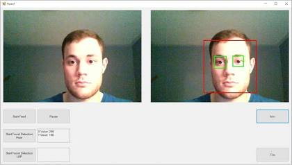

# OpenCV ile Yüz Tanıma

Bu proje, bilgisayara bağlı webcam'den canlı görüntü alan ve her karede yüzleri Haar cascade sınıflandırıcısıyla algılayan bir Windows Forms uygulamasıdır. Algılanan yüzler yeşil çerçeveyle işaretlenir, ekranda yüz sayısı ve kare hızı (FPS) gösterilir.

Bu uygulama Nesne Tabanlı Programlama dersi ödevi kapsamında geliştirilmiştir.

## Kullanılan Teknolojiler

- C#
- .NET 8 (`net8.0-windows`)
- Windows Forms
- OpenCvSharp4 (4.9.0.20240103)
- Haar Cascade (`haarcascade_frontalface_default.xml`)

## Proje Yapısı

- `MainForm.cs`: Arayüz, görüntü gösterimi, buton ve etiketler
- `WebcamService.cs`: Webcam'i arka plan thread'inde okuyan servis
- `FaceDetector.cs`: Haar cascade ile yüz algılama
- `Program.cs`: Uygulamanın giriş noktası
- `Assets/`: Haar cascade dosyasının bulunduğu klasör

## Çalıştırma Adımları

1. Windows işletim sisteminde [.NET 8 SDK](https://dotnet.microsoft.com/download/dotnet/8.0) kurulu olmalıdır.
2. Bilgisayara bir webcam bağlı olmalıdır.
3. Haar cascade dosyasını yerleştirin (aşağıdaki bölüme bakın).
4. Projeyi derleyip çalıştırın. Terminalden:

   ```bash
   dotnet restore
   dotnet run
   ```

   Ya da Visual Studio'da `FaceDetection.csproj` dosyasını açıp **F5** tuşuna basın.
5. Uygulama açıldığında **Başlat** düğmesine basarak webcam görüntüsünü başlatın, **Durdur** ile kapatın.

### Haar cascade dosyası

Yüz algılama için `haarcascade_frontalface_default.xml` dosyası gereklidir. Bu dosya depoda **bulunmuyorsa** aşağıdaki adresten indirip `Assets/` klasörüne koyun:

<https://raw.githubusercontent.com/opencv/opencv/4.x/data/haarcascades/haarcascade_frontalface_default.xml>

Dosyanın tam yolu şu şekilde olmalıdır:

```
Assets/haarcascade_frontalface_default.xml
```

Dosya derleme çıktısına (`bin/.../Assets/`) otomatik kopyalanır. Dosya eksikse uygulama açılır ancak **Başlat** düğmesi pasif kalır ve durum satırında hata gösterilir.

## Ekran Görüntüleri

Uygulamanın çalışır halinden örnekler:




> Not: Ekran görüntüleri (`ekran1.png`, `ekran2.png`) henüz eklenmedi. Bu dosyalar webcam bağlı bir Windows makinesinde uygulama çalıştırılarak alınıp `docs/screenshots/` klasörüne eklenecektir. Dosyalar eklenene kadar yukarıdaki bağlantılar görünmeyebilir.
